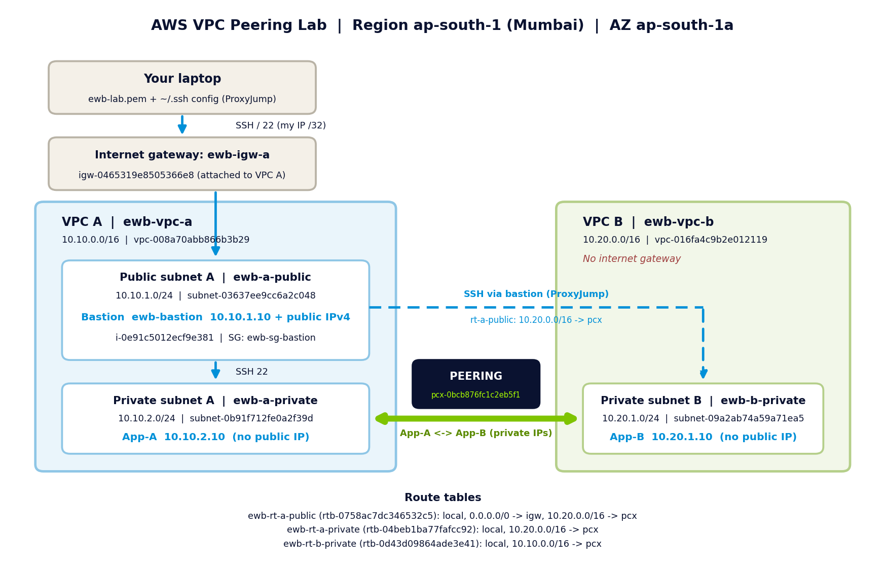

# AWS VPC Peering Lab

Two VPCs connected with VPC peering, with proof of private connectivity. Built on AWS with EC2, custom route tables, security groups and a bastion host. The whole lab is created, tested and removed by one AWS CLI script.

Project 01 of the EWB Courses AWS Architect Associate track (EWB Cloud Labs).



## What it builds

| Resource | Details |
|---|---|
| VPC A `ewb-vpc-a` | 10.10.0.0/16, public subnet 10.10.1.0/24, private subnet 10.10.2.0/24, internet gateway |
| VPC B `ewb-vpc-b` | 10.20.0.0/16, private subnet 10.20.1.0/24, no internet gateway |
| Peering `ewb-a-b-peer` | VPC A (requester) to VPC B (accepter), same account and Region |
| EC2 (Amazon Linux 2023, t3.micro) | `ewb-bastion` 10.10.1.10 (public), `ewb-app-a` 10.10.2.10 and `ewb-app-b` 10.20.1.10 (no public IP) |
| Route tables | public: local, 0.0.0.0/0 to IGW, 10.20.0.0/16 to pcx. A-private: 10.20.0.0/16 to pcx. B-private: 10.10.0.0/16 to pcx |
| Security groups | SSH only from my /32 (bastion) or the bastion private IP (apps). ICMP echo only between App-A and App-B as /32 |

Administration path: laptop > bastion > App-A or App-B with SSH `ProxyJump`. The private key never leaves the laptop.

## Results

| Test | Result |
|---|---|
| 01 Baseline: App-A pings App-B before peering | 100% packet loss (expected) |
| 02 Forward: App-A to App-B after routes | 4/4 replies, 0% loss |
| 03 Reverse: App-B to App-A | 4/4 replies, 0% loss |
| 04 SSH to App-B through the bastion | Shell on `ip-10-20-1-10` |
| 05 Isolation | No public IPv4 on App-A or App-B |
| 06 Controlled failure: remove ICMP rule on `ewb-sg-app-b` | 100% packet loss |
| 07 Recovery: restore the exact rule | 4/4 replies, 0% loss |

Evidence is in [`screenshots/`](screenshots) and the full write-up is in [`docs/Abhishek_EWB_VPC_Peering.pdf`](docs/Abhishek_EWB_VPC_Peering.pdf).

## Run it yourself

Requirements: AWS CLI v2 logged in to a **lab** account, `ssh`, `curl`, WSL/macOS/Linux, permission to manage VPC, EC2 and key pairs.

```bash
export STUDENT=yourname            # no spaces, used in resource tags
cd scripts
chmod +x ewb-vpc-peering.sh

./ewb-vpc-peering.sh build         # VPCs, subnets, IGW, routes, SGs, key pair, 3 EC2, ssh config
./ewb-vpc-peering.sh baseline      # ping must FAIL before peering
./ewb-vpc-peering.sh peer          # create + accept peering, add routes on both sides
./ewb-vpc-peering.sh show          # routes, associations, SG rules
./ewb-vpc-peering.sh test          # forward, reverse, SSH to App-B, isolation
./ewb-vpc-peering.sh fail          # controlled failure and recovery
./ewb-vpc-peering.sh cleanup       # remove everything and list leftovers
```

Default Region is `ap-south-1`; override with `AWS_REGION`. Outputs are saved to `~/ewb-evidence/`.

## Cost and safety

- Roughly $0.04 per hour for 3 x t3.micro, 3 x 8 GB gp3 and one public IPv4 (check current pricing). VPCs, peering and route tables are free. There is no NAT gateway.
- Run `cleanup` the same day, then check EC2, Volumes, Elastic IPs and Billing.
- SSH and ICMP are never open to `0.0.0.0/0`.
- Never commit `*.pem`, `~/.aws` or the state file. `.gitignore` already blocks them.
- Screenshots in this repo have account IDs, my public IP and bastion IP blurred.

## Repo layout

```
scripts/ewb-vpc-peering.sh     build / test / cleanup script
docs/architecture.png          architecture diagram with real resource IDs
docs/Abhishek_EWB_VPC_Peering.pdf   project report
screenshots/                   console and terminal evidence
```

## What I learned

- A peering connection is only a link. Both sides need routes, and security groups must allow the traffic.
- A failed test before peering proves the later success comes from the peering and routes.
- Peering is non-transitive. VPC B cannot use VPC A's internet gateway.
- Scripting with consistent tags makes the lab repeatable and cleanup safe.
